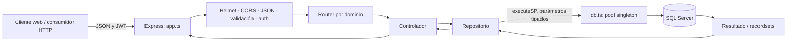
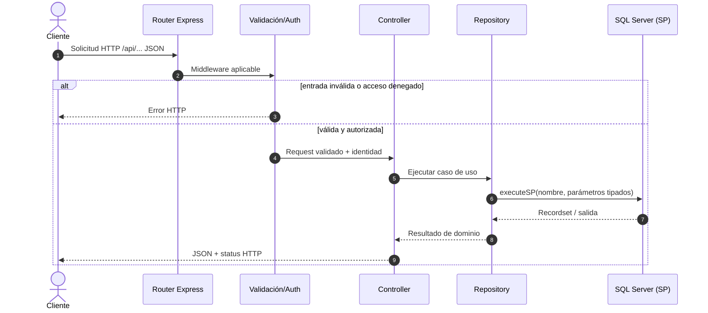
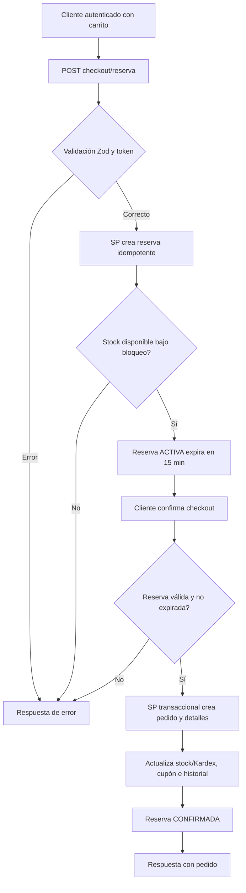
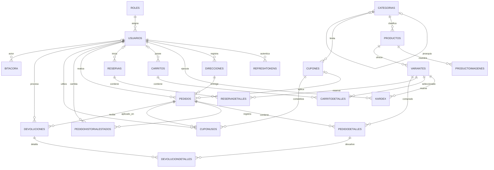
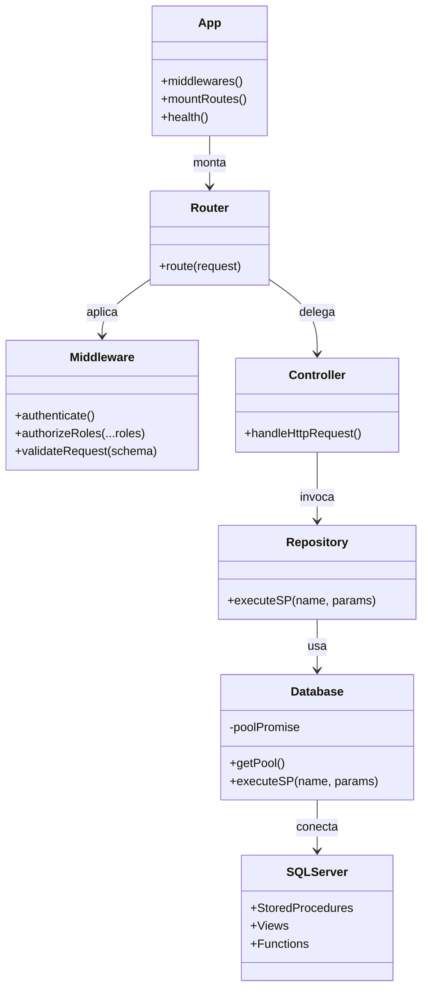
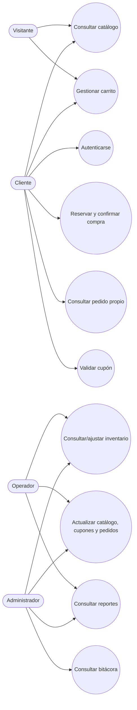

# ShopCart — Don Arturo / Grupo Pentandra

API REST para una plataforma de comercio electrónico. El backend está construido con Node.js, Express y TypeScript; SQL Server concentra el modelo de datos y las reglas transaccionales mediante procedimientos almacenados. La moneda de negocio es GTQ y los precios consideran IVA del 12%.

> Este documento describe el estado observado en el repositorio: `backend/src`, `database/`, `docs/` y `local-documentation/`. Los diagramas representan las relaciones declaradas en DDL y los flujos presentes en rutas/procedimientos; los sistemas de pago externos no están integrados en el código revisado.

## Índice

- [Resumen de arquitectura](#resumen-de-arquitectura)
- [Estructura del repositorio](#estructura-del-repositorio)
- [Backend: responsabilidades por carpeta](#backend-responsabilidades-por-carpeta)
- [Base de datos](#base-de-datos)
- [Requisitos y puesta en marcha](#requisitos-y-puesta-en-marcha)
- [API HTTP](#api-http)
- [Autenticación y autorización](#autenticación-y-autorización)
- [Diagramas](#diagramas)
- [Decisiones de arquitectura](#decisiones-de-arquitectura)
- [Limitaciones conocidas del alcance](#limitaciones-conocidas-del-alcance)

## Resumen de arquitectura

La aplicación expone Express bajo `/api`. Los routers delegan en controladores; estos coordinan validación de entrada y repositorios; cada repositorio invoca procedimientos SQL con parámetros tipados a través de `executeSP`. No se usa ORM ni se construyen consultas SQL inline en el backend.

Al arrancar, `server.ts` establece la conexión SQL antes de abrir el puerto HTTP. `db.ts` reutiliza un pool singleton (máximo 20 conexiones, mínimo 2, expiración inactiva de 30 s). La base de datos mantiene entidades, restricciones, vistas, funciones, procedimientos y datos iniciales.



## Estructura del repositorio

| Ruta | Contenido y función |
|---|---|
| `backend/` | Proyecto Node.js/TypeScript de la API. Incluye configuración, fuentes, dependencias locales y salida compilada. |
| `backend/src/` | Código fuente mantenible de la API. |
| `backend/dist/` | JavaScript generado por `pnpm build`; no editar manualmente. |
| `backend/node_modules/` | Dependencias instaladas por pnpm; no versionar. |
| `database/` | Scripts SQL de instalación por fases y carga de datos de ejemplo. |
| `docs/architecture-decisions/` | ADR-001 y ADR-002, decisiones técnicas del proyecto. |
| `local-documentation/` | ADR-003 sobre modularidad y notas/comandos locales para Docker/SQL Server. |
| `docker-compose.yml` | Definición de servicios locales con Docker Compose. |
| `Reto_ShopCart_Enunciado.md` | Enunciado funcional original del reto. |
| `README.md` | Guía técnica y operativa del repositorio. |

### Archivos raíz y backend

- `backend/package.json`: comandos `dev`, `build`, `start`, `lint` y `typecheck`; dependencias de Express, mssql, Zod, JWT, bcrypt, CORS, Helmet y Swagger.
- `backend/pnpm-lock.yaml`: versiones resueltas de dependencias.
- `backend/tsconfig.json`: opciones del compilador TypeScript.
- `backend/eslint.config.mjs`: reglas de lint.
- `backend/.env.example`: nombres y valores de ejemplo para configurar el servicio. `backend/.env` es local y no debe publicarse.
- `backend/src/server.ts`: comprueba conexión SQL y comienza a escuchar.
- `backend/src/app.ts`: middleware global, salud, Swagger, montaje de routers y 404.

## Backend: responsabilidades por carpeta

### Infraestructura transversal (`backend/src/`)

| Carpeta/archivo | Responsabilidad |
|---|---|
| `config/env.ts` | Carga `.env`, valida variables con Zod y aplica defaults; termina el proceso si faltan valores obligatorios o los secretos JWT son menores a 16 caracteres. |
| `config/swagger.ts` | Define OpenAPI 3.0.3, servidor, tags, seguridad bearer y documentación de endpoints. |
| `database/db.ts` | Configura SQL Server, crea/reutiliza el pool, expone `SPParam`, `executeSP` y el namespace `sql`. Reinicia el pool promise si falla la conexión. |
| `middlewares/auth.middleware.ts` | Autenticación JWT obligatoria/opcional y control por rol. El carrito admite sesión anónima. |
| `middlewares/validate.middleware.ts` | Ejecuta esquemas Zod sobre las solicitudes y detiene entradas inválidas. |
| `middlewares/error.middleware.ts` | Traduce errores de aplicación a respuestas HTTP centralizadas. |
| `errors/AppError.ts` | Error de aplicación con datos para comunicar status/mensaje. |
| `utils/jwt.ts` | Firma y verifica tokens de acceso/renovación. |

### Módulos por dominio (`backend/src/modules/`)

Cada módulo mantiene el mismo patrón: `*.routes.ts` define URL y guards; `*.schema.ts` declara validación Zod; `*.controller.ts` adapta HTTP; `*.repository.ts` encapsula llamadas al SP. `auth` incluye además `auth.service.ts` para operaciones de autenticación y tokens.

| Módulo | Funcionalidad |
|---|---|
| `auth/` | Registro, login, refresh con rotación, logout, perfil, direcciones y administración de usuarios. |
| `catalogo/` | Categorías, productos, detalle público, variantes e imágenes relacionadas. Mutaciones administrativas requieren Administrador. |
| `inventario/` | Existencias, movimientos Kardex y ajustes manuales; Operador o Administrador. |
| `carrito/` | Carrito de invitado o autenticado, agregar/eliminar/vaciar ítems y migrar/combinar carrito al autenticarse. |
| `cupones/` | Validación del cupón para el carrito y mantenimiento administrativo. |
| `pedidos/` | Reserva de existencias, confirmación del checkout, consulta, ciclo de estado, cancelación y devolución. |
| `reportes/` | Ventas por periodo/categoría, top productos y carritos abandonados. |
| `bitacora/` | Consulta administrativa de eventos de auditoría. |

## Base de datos

Los scripts SQL se ejecutan en orden. Los nombres de tablas y objetos se corresponden con el esquema implementado.

| Ruta | Contenido |
|---|---|
| `database/01_schema/01_DDL_Tablas.sql` | Crea 22 tablas, PK/FK, defaults y restricciones CHECK/UNIQUE. Incluye trigger de inmutabilidad de `Bitacora`. |
| `database/01_schema/02_DDL_Indices.sql` | Índices para consultas habituales de usuarios, catálogo, inventario, carrito y pedidos. |
| `database/02_views/01_VW_VistasSistema.sql` | Vistas de lectura y agregados usados por la aplicación. |
| `database/03_functions/01_FU_FuncionesTabla.sql` | Funciones de tabla; incluye generación de series temporales usando tally table según ADR-002. |
| `database/04_stored_procedures/01_SP_Auth_Usuarios.sql` | Usuarios, autenticación, tokens y direcciones. |
| `database/04_stored_procedures/02_SP_Catalogo.sql` | Categorías, productos, variantes y consulta de catálogo. |
| `database/04_stored_procedures/03_SP_Inventario_Kardex.sql` | Consultas y ajustes de existencias/Kardex. |
| `database/04_stored_procedures/04_SP_Carrito.sql` | Operaciones de carrito y migración del invitado. |
| `database/04_stored_procedures/05_SP_Cupones.sql` | Alta, consulta, validación y estado de cupones. |
| `database/04_stored_procedures/06_SP_Checkout_Pedidos.sql` | Reserva, confirmación de pedido, estado, cancelación y devolución; transacciones y control de concurrencia. |
| `database/04_stored_procedures/07_SP_Reportes_Dashboard.sql` | Consultas para dashboard e informes. |
| `database/04_stored_procedures/08_SP_Bitacora.sql` | Escritura/consulta de eventos de auditoría. |
| `database/05_seed/01_Seed_DatosIniciales.sql` | Datos de referencia, roles, catálogo y cuentas de demostración. |

### Entidades principales

- **Identidad:** `Roles`, `Usuarios`, `RefreshTokens`, `Direcciones`.
- **Catálogo:** `Categorias` (jerárquica), `Productos`, `ProductoImagenes`, `Variantes`.
- **Existencias:** `Kardex` registra usuario, variante, cantidad, existencias anterior/nueva, tipo y referencia.
- **Carrito y cupón:** `Carritos`, `CarritoDetalles`, `Cupones`.
- **Checkout:** `Reservas`, `ReservaDetalles`, con clave de idempotencia y expiración; el SP documenta reserva de 15 minutos y bloqueos `UPDLOCK, HOLDLOCK`.
- **Pedido:** `Pedidos`, `PedidoDetalles`, `PedidoHistorialEstados`, `CuponUsos`, `Devoluciones`, `DevolucionDetalles`.
- **Auditoría:** `Bitacora`; el DDL bloquea UPDATE/DELETE mediante trigger.

Las tablas de asociación y snapshot conservan detalle histórico. Por ejemplo, `PedidoDetalles` almacena SKU, nombre y precio al momento de comprar; `Pedidos` conserva dirección y código de cupón como snapshot. La disponibilidad deriva de la existencia física menos las cantidades reservadas activas; consultar las vistas/SP correspondientes para la definición concreta.

## Requisitos y puesta en marcha

### Requisitos

- Node.js compatible con las dependencias del proyecto y `pnpm`.
- SQL Server accesible desde el backend (SQL Server 2019+ recomendado por la configuración de ejemplo).
- Docker Compose si se quiere levantar el servicio SQL local declarado en `docker-compose.yml`.

### Preparar la base

1. Inicia el SQL Server local con `docker compose up -d` (revisa `docker-compose.yml` para nombre, puerto y credenciales configurados).
2. Crea la base `ShopCartDB` si no fue creada por el entorno.
3. Ejecuta en este orden los scripts: `01_schema/01_DDL_Tablas.sql`, `01_schema/02_DDL_Indices.sql`, `02_views/01_VW_VistasSistema.sql`, `03_functions/01_FU_FuncionesTabla.sql`, todos los SP numerados del 01 al 08 y finalmente `05_seed/01_Seed_DatosIniciales.sql`.
4. Los comandos PowerShell de `local-documentation/dockercomands.md` muestran una forma de enviarlos al contenedor con `sqlcmd`; actualiza usuario/contraseña según tu entorno. No uses credenciales de ejemplo en ambientes públicos.

### Configurar y ejecutar API

Desde `backend/`:

```powershell
pnpm install
Copy-Item .env.example .env
```

Edita `.env` con los datos reales de SQL Server y secretos JWT propios (mínimo 16 caracteres). Variables aceptadas:

| Variable | Uso | Default |
|---|---|---|
| `PORT` | Puerto HTTP | `3000` |
| `NODE_ENV` | `development`, `production` o `test` | `development` |
| `DB_SERVER`, `DB_USER`, `DB_PASSWORD`, `DB_NAME` | Conexión SQL requeridos | — |
| `DB_PORT` | Puerto SQL Server | `1433` |
| `DB_ENCRYPT` | Cifrado de conexión | `false` |
| `DB_TRUST_SERVER_CERTIFICATE` | Confianza del certificado SQL | `true` |
| `JWT_ACCESS_SECRET` | Firma de access token (mínimo 16 caracteres) | — |
| `JWT_ACCESS_EXPIRES_IN` | Vigencia access token | `15m` |
| `JWT_REFRESH_SECRET` | Firma de refresh token (mínimo 16 caracteres) | — |
| `JWT_REFRESH_EXPIRES_IN` | Vigencia refresh token | `7d` |
| `CORS_ORIGIN` | Origen permitido | `http://localhost:5173` |

```powershell
pnpm dev        # Desarrollo con recarga
pnpm typecheck  # Verificación estática de TypeScript
pnpm lint       # ESLint
pnpm build      # Compila a dist/
pnpm start      # Ejecuta dist/server.js
```

La API ofrece `GET /api/health` y Swagger UI en `http://localhost:3000/api/docs` (ajusta el puerto si cambias `PORT`). El servidor solo comienza a aceptar solicitudes cuando la conexión inicial con SQL Server tiene éxito.

## API HTTP

Todas las rutas están bajo `/api`. Las entradas se validan con Zod cuando la ruta declara esquema. Los permisos se aplican en middleware de rutas; `GET /api/health` es público.

| Prefijo | Operaciones principales | Acceso |
|---|---|---|
| `/api/auth` | `POST /register`, `/login`, `/refresh`, `/logout`; `GET /me`, `/direcciones`; `POST /direcciones`; `PUT/DELETE /direcciones/:id`; `GET /usuarios`; `PATCH /usuarios/:id/estado` | Registro/login/refresh/logout públicos; perfil y direcciones autenticados; usuarios solo Administrador. |
| `/api/catalogo` | `GET /categorias`, `/productos`, `/productos/:codigoPublico`; mutaciones de categorías/productos/variantes | Lecturas públicas; mutaciones solo Administrador. |
| `/api/inventario` | `GET /existencias`, `/kardex`; `POST /ajuste` | Operador o Administrador. |
| `/api/carrito` | `GET /`; `POST /items`, `/migrar`; `DELETE /items/:idVariante`, `/` | Invitado o usuario autenticado, excepto migración que requiere login. Invitados se identifican mediante `x-guest-token` según el controlador. |
| `/api/cupones` | `POST /validar`; `GET/POST /`; `PATCH /:id/estado` | Validación autenticada; administración solo Administrador. |
| `/api/pedidos` | `POST /checkout/reserva`, `/checkout/confirmar`; `GET /mis-pedidos`, `/`, `/:codigoPublico`; `PATCH /:id/estado`; `POST /:id/cancelar`, `/:id/devoluciones` | Checkout/propios autenticado; operaciones generales para Operador/Administrador; detalle aplica autorización por propietario/rol. |
| `/api/reportes` | `GET /ventas-periodo`, `/top-productos`, `/ventas-categoria`, `/carritos-abandonados` | Operador o Administrador. |
| `/api/bitacora` | `GET /` | Solo Administrador. |

La descripción completa de parámetros/respuestas se publica en Swagger. Los identificadores internos numéricos se usan en relaciones y mantenimiento; los recursos expuestos al cliente incluyen `CodigoPublico` UUID conforme a ADR-001.

## Autenticación y autorización

- `POST /api/auth/login` devuelve access token JWT y refresh token. El access token tiene vigencia configurable (15 min por defecto); el refresh, 7 días.
- `POST /api/auth/refresh` renueva tokens y rota/revoca el refresh previo. `POST /logout` revoca el refresh presentado.
- Rutas protegidas envían `Authorization: Bearer <accessToken>`.
- Los roles sembrados son Administrador, Operador y Cliente. El middleware controla los permisos descritos en la tabla de endpoints.
- Las contraseñas se manejan con bcrypt en los servicios de autenticación; la base guarda hash, no contraseña en claro.

## Diagramas

### Flujo de solicitud y consulta de catálogo



### Flujo de checkout



### Diagrama entidad-relación

Se muestran las relaciones FK declaradas en `01_DDL_Tablas.sql`; se omiten atributos no clave para que el diagrama sea legible. `Kardex.IDReferencia` es una referencia polimórfica descrita por comentario y no declara FK.



### Diagrama UML de componentes y clases



### Casos de uso



## Decisiones de arquitectura

- [ADR-001: identificadores internos vs. públicos](docs/architecture-decisions/ADR-001-identificadores-internos-vs-publicos.md): claves internas numéricas para relaciones eficientes; UUID `CodigoPublico` para exponer recursos sin publicar la secuencia interna.
- [ADR-002: generación de series temporales con tally table](docs/architecture-decisions/ADR-002-generacion-series-temporales-tally-table.md): generación de periodos para reportes sin depender de bucles iterativos.
- [ADR-003: arquitectura modular por dominio](local-documentation/ADR-003-arquitectura-modular-por-dominio.md): separación del backend por capacidades funcionales y capas de transporte, controlador y persistencia.
- [Notas de comandos Docker/SQL](local-documentation/dockercomands.md): ejecución local manual de scripts y consultas de diagnóstico.

## Limitaciones conocidas del alcance

- El procedimiento de checkout recibe método e identificador de transacción de pago; en este repositorio no se observa integración con una pasarela que procese el cobro. La confirmación de pago debe entenderse como parte del flujo interno/mock indicado por esos datos.
- Los diagramas ER muestran las FK reales; referencias que solo existan como comentario (por ejemplo `Kardex.IDReferencia`) no se dibujan como relaciones garantizadas por la base.
- La especificación Swagger se mantiene en `backend/src/config/swagger.ts`; al añadir/quitar rutas, actualiza también esa definición y este README.
