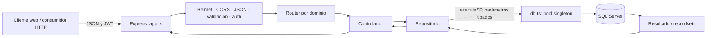
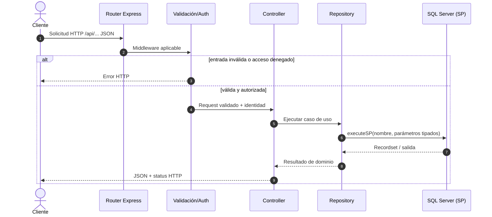
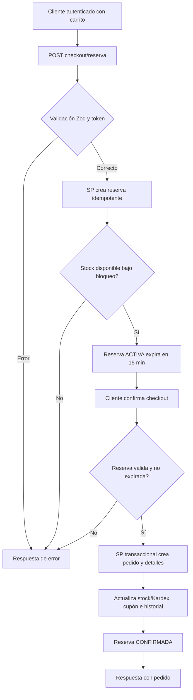
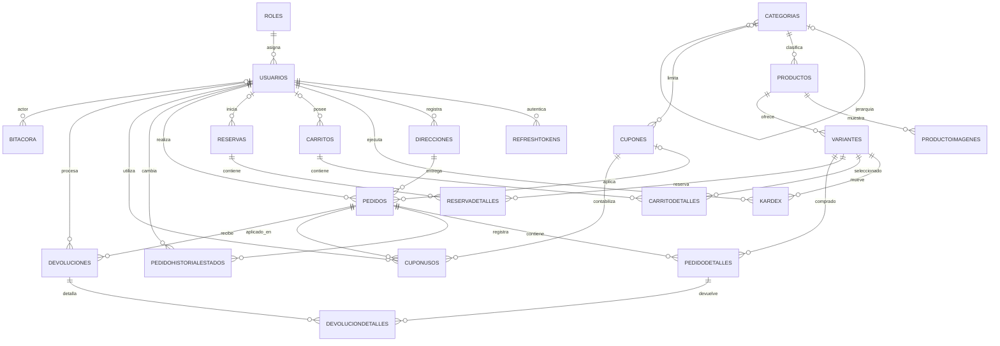
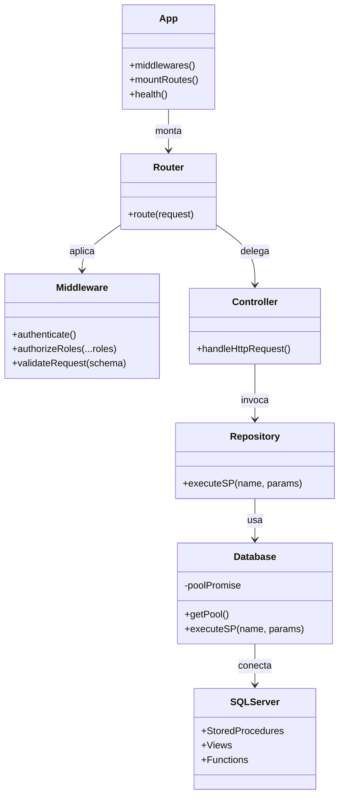

# ShopCart — Don Arturo / Grupo Pentandra

API REST para una plataforma de comercio electrónico. El backend está construido con Node.js, Express y TypeScript; SQL Server concentra el modelo de datos y las reglas transaccionales mediante procedimientos almacenados. La moneda de negocio es GTQ y los precios consideran IVA del 12%.

> Este documento describe el estado observado en el repositorio: `backend/src`, `database/` y `docs/`. Los diagramas representan las relaciones declaradas en DDL y los flujos presentes en rutas/procedimientos; los sistemas de pago externos no están integrados en el código revisado.

## Índice

- [Resumen de arquitectura](#resumen-de-arquitectura)
- [Estructura del repositorio](#estructura-del-repositorio)
- [Backend: responsabilidades por carpeta](#backend-responsabilidades-por-carpeta)
- [Base de datos](#base-de-datos)
- [Requisitos y puesta en marcha](#requisitos-y-puesta-en-marcha)
- [Frontend: estructura y funcionamiento](#frontend-estructura-y-funcionamiento)
- [Pruebas y calidad](#pruebas-y-calidad)
- [API HTTP](#api-http)
- [Autenticación y autorización](#autenticación-y-autorización)
- [Diagramas](#diagramas)
- [Decisiones de arquitectura](#decisiones-de-arquitectura)
- [Limitaciones conocidas del alcance](#limitaciones-conocidas-del-alcance)

## Resumen de arquitectura

La aplicación expone Express bajo `/api`. Los routers delegan en controladores; estos coordinan validación de entrada y repositorios; cada repositorio invoca procedimientos SQL con parámetros tipados a través de `executeSP`. No se usa ORM ni se construyen consultas SQL inline en el backend.

Al arrancar, `server.ts` establece la conexión SQL antes de abrir el puerto HTTP. `db.ts` reutiliza un pool singleton (máximo 20 conexiones, mínimo 2, expiración inactiva de 30 s). La base de datos mantiene entidades, restricciones, vistas, funciones, procedimientos y datos iniciales.



## Estructura del repositorio

| Ruta | Contenido y función |
|---|---|
| `backend/` | Proyecto Node.js/TypeScript de la API. Incluye configuración, fuentes, dependencias locales y salida compilada. |
| `backend/src/` | Código fuente mantenible de la API. |
| `backend/dist/` | JavaScript generado por `pnpm build`; no editar manualmente. |
| `backend/node_modules/` | Dependencias instaladas por pnpm; no versionar. |
| `database/` | Scripts SQL de instalación por fases y carga de datos de ejemplo. |
| `docs/architecture-decisions/` | ADR-001, ADR-002 y ADR-003, decisiones técnicas del proyecto. |
| `docs/decisiones-frontend.md` | Registro descriptivo de las decisiones de arquitectura, seguridad, UI y calidad del frontend. |
| `docs/guia-pruebas-swagger-y-docker.md` | Guía operativa de comandos Docker y pruebas paso a paso en Swagger UI. |
| `docker-compose.yml` | Define SQL Server y el backend. El backend usa la imagen publicada `glendyt/shopcart-backend:1.0.0` y conserva `build` para reconstruirla desde el código local. |
| `backend/Dockerfile` | Construcción multi-stage de la API: instala dependencias, compila TypeScript y crea la imagen de ejecución. |
| `backend/pnpm-workspace.yaml` | Política de ejecución de scripts de dependencias durante la instalación en Docker (`esbuild` permitido). |
| `.env.docker.example` | Plantilla local de variables que Compose usa para SQL Server y la conexión entre servicios. |
| `Reto_ShopCart_Enunciado.md` | Enunciado funcional original del reto. |
| `README.md` | Guía técnica y operativa del repositorio. |

### Archivos raíz y backend

- `backend/package.json`: comandos `dev`, `build`, `start`, `lint` y `typecheck`; dependencias de Express, mssql, Zod, JWT, bcrypt, CORS, Helmet y Swagger.
- `backend/pnpm-lock.yaml`: versiones resueltas de dependencias.
- `backend/tsconfig.json`: opciones del compilador TypeScript.
- `backend/eslint.config.mjs`: reglas de lint.
- `backend/.env.example`: nombres y valores de ejemplo para configurar el servicio. `backend/.env` es local y no debe publicarse.
- `backend/src/server.ts`: comprueba conexión SQL y comienza a escuchar.
- `backend/src/app.ts`: middleware global, salud, Swagger, montaje de routers y 404.

## Backend: responsabilidades por carpeta

### Infraestructura transversal (`backend/src/`)

| Carpeta/archivo | Responsabilidad |
|---|---|
| `config/env.ts` | Carga `.env`, valida variables con Zod y aplica defaults; termina el proceso si faltan valores obligatorios o los secretos JWT son menores a 16 caracteres. |
| `config/swagger.ts` | Define OpenAPI 3.0.3, servidor, tags, seguridad bearer y documentación de endpoints. |
| `database/db.ts` | Configura SQL Server, crea/reutiliza el pool, expone `SPParam`, `executeSP` y el namespace `sql`. Reinicia el pool promise si falla la conexión. |
| `middlewares/auth.middleware.ts` | Autenticación JWT obligatoria/opcional y control por rol. El carrito admite sesión anónima. |
| `middlewares/validate.middleware.ts` | Ejecuta esquemas Zod sobre las solicitudes y detiene entradas inválidas. |
| `middlewares/error.middleware.ts` | Traduce errores de aplicación a respuestas HTTP centralizadas. |
| `errors/AppError.ts` | Error de aplicación con datos para comunicar status/mensaje. |
| `utils/jwt.ts` | Firma y verifica tokens de acceso/renovación. |

### Módulos por dominio (`backend/src/modules/`)

Cada módulo mantiene el mismo patrón: `*.routes.ts` define URL y guards; `*.schema.ts` declara validación Zod; `*.controller.ts` adapta HTTP; `*.repository.ts` encapsula llamadas al SP. `auth` incluye además `auth.service.ts` para operaciones de autenticación y tokens.

| Módulo | Funcionalidad |
|---|---|
| `auth/` | Registro, login, refresh con rotación, logout, perfil, direcciones y administración de usuarios. |
| `catalogo/` | Categorías, productos, detalle público, variantes e imágenes relacionadas. Mutaciones administrativas requieren Administrador. |
| `inventario/` | Existencias, movimientos Kardex y ajustes manuales; Operador o Administrador. |
| `carrito/` | Carrito de invitado o autenticado, agregar/eliminar/vaciar ítems y migrar/combinar carrito al autenticarse. |
| `cupones/` | Validación del cupón para el carrito y mantenimiento administrativo. |
| `pedidos/` | Reserva de existencias, confirmación del checkout, consulta, ciclo de estado, cancelación y devolución. |
| `reportes/` | Ventas por periodo/categoría, top productos y carritos abandonados. |
| `bitacora/` | Consulta administrativa de eventos de auditoría. |

## Base de datos

Los scripts SQL se ejecutan en orden. Los nombres de tablas y objetos se corresponden con el esquema implementado.

| Ruta | Contenido |
|---|---|
| `database/01_schema/01_DDL_Tablas.sql` | Crea 22 tablas, PK/FK, defaults y restricciones CHECK/UNIQUE. Incluye trigger de inmutabilidad de `Bitacora`. |
| `database/01_schema/02_DDL_Indices.sql` | Índices para consultas habituales de usuarios, catálogo, inventario, carrito y pedidos. |
| `database/02_views/01_VW_VistasSistema.sql` | Vistas de lectura y agregados usados por la aplicación. |
| `database/03_functions/01_FU_FuncionesTabla.sql` | Funciones de tabla; incluye generación de series temporales usando tally table según ADR-002. |
| `database/04_stored_procedures/01_SP_Auth_Usuarios.sql` | Usuarios, autenticación, tokens y direcciones. |
| `database/04_stored_procedures/02_SP_Catalogo.sql` | Categorías, productos, variantes y consulta de catálogo. |
| `database/04_stored_procedures/03_SP_Inventario_Kardex.sql` | Consultas y ajustes de existencias/Kardex. |
| `database/04_stored_procedures/04_SP_Carrito.sql` | Operaciones de carrito y migración del invitado. |
| `database/04_stored_procedures/05_SP_Cupones.sql` | Alta, consulta, validación y estado de cupones. |
| `database/04_stored_procedures/06_SP_Checkout_Pedidos.sql` | Reserva, confirmación de pedido, estado, cancelación y devolución; transacciones y control de concurrencia. |
| `database/04_stored_procedures/07_SP_Reportes_Dashboard.sql` | Consultas para dashboard e informes. |
| `database/04_stored_procedures/08_SP_Bitacora.sql` | Escritura/consulta de eventos de auditoría. |
| `database/05_seed/01_Seed_DatosIniciales.sql` | Datos de referencia, roles, catálogo y cuentas de demostración. |
| `database/05_seed/02_Seed_CatalogoGeneral.sql` | Productos de demostración para electrodomésticos, tecnología, mascotas y deportes. Ejecutar después del seed inicial. |

### Entidades principales

- **Identidad:** `Roles`, `Usuarios`, `RefreshTokens`, `Direcciones`.
- **Catálogo:** `Categorias` (jerárquica), `Productos`, `ProductoImagenes`, `Variantes`.
- **Existencias:** `Kardex` registra usuario, variante, cantidad, existencias anterior/nueva, tipo y referencia.
- **Carrito y cupón:** `Carritos`, `CarritoDetalles`, `Cupones`.
- **Checkout:** `Reservas`, `ReservaDetalles`, con clave de idempotencia y expiración; el SP documenta reserva de 15 minutos y bloqueos `UPDLOCK, HOLDLOCK`.
- **Pedido:** `Pedidos`, `PedidoDetalles`, `PedidoHistorialEstados`, `CuponUsos`, `Devoluciones`, `DevolucionDetalles`.
- **Auditoría:** `Bitacora`; el DDL bloquea UPDATE/DELETE mediante trigger.

Las tablas de asociación y snapshot conservan detalle histórico. Por ejemplo, `PedidoDetalles` almacena SKU, nombre y precio al momento de comprar; `Pedidos` conserva dirección y código de cupón como snapshot. La disponibilidad deriva de la existencia física menos las cantidades reservadas activas; consultar las vistas/SP correspondientes para la definición concreta.

## Requisitos y puesta en marcha

### Requisitos

- Node.js compatible con las dependencias del proyecto y `pnpm`.
- SQL Server accesible desde el backend (SQL Server 2019+ recomendado por la configuración de ejemplo).
- Docker Compose si se quiere levantar el servicio SQL local declarado en `docker-compose.yml`.

### Descargar y ejecutar la imagen publicada

La imagen del backend está publicada en Docker Hub como [`glendyt/shopcart-backend:1.0.0`](https://hub.docker.com/r/glendyt/shopcart-backend). Para descargarla manualmente:

```powershell
docker login
docker pull glendyt/shopcart-backend:1.0.0
```

Para arrancar el sistema en otra máquina, clona/descarga este repositorio (se requiere el Compose y los scripts SQL), prepara los archivos de configuración de abajo y luego ejecuta `docker compose pull backend` seguido de `docker compose up -d --no-build`. El flag `--no-build` hace que Compose utilice la imagen descargada en Docker Hub. La primera vez, el esquema SQL debe inicializarse como se describe más adelante.

### Construir y publicar una versión nueva

Con sesión iniciada en Docker Hub, desde la raíz del repositorio:

```powershell
docker build -t glendyt/shopcart-backend:1.0.0 ./backend
docker push glendyt/shopcart-backend:1.0.0
```

Al publicar una nueva versión, incrementa la etiqueta (por ejemplo `1.0.1`) en el comando `docker build` y en `docker-compose.yml`, y vuelve a ejecutar `docker push`. Compose también puede reconstruir desde el código local con `docker compose up -d --build`; el bloque `build` etiqueta la imagen local con el nombre indicado en `image`.

### Arranque con Docker Compose

El `docker-compose.yml` levanta SQL Server y la API. Para usar Docker, desde la raíz del repositorio:

```powershell
Copy-Item .env.docker.example .env
Copy-Item backend/.env.example backend/.env
```

Reemplaza `DB_PASSWORD` en el `.env` raíz por una contraseña propia que cumpla los requisitos de SQL Server (mayúscula, minúscula, número y símbolo, al menos 8 caracteres). En `backend/.env`, configura `JWT_ACCESS_SECRET` y `JWT_REFRESH_SECRET` con claves propias de al menos 16 caracteres. Luego arranca los servicios:

```powershell
docker compose up -d --build
docker compose ps
```

El comando anterior construye la imagen desde el Dockerfile local. Para usar la versión ya publicada en Docker Hub en lugar de reconstruir el código:

```powershell
docker compose pull backend
docker compose up -d --no-build
docker compose ps
```

La API queda en `http://localhost:3000`; Swagger en `/api/docs`. El backend espera a que el contenedor SQL Server responda al healthcheck. El volumen `mssql_data` conserva los datos entre reinicios. El contenedor `backend` requiere `backend/.env` para los secretos JWT; no publiques ese archivo. El `.env` raíz proporciona `DB_PASSWORD` y `DB_NAME` a Compose.

**Inicialización de la base:** el contenedor SQL Server no ejecuta automáticamente los scripts de `database/`. Crea `ShopCartDB` y aplica, en orden, `01_schema/01_DDL_Tablas.sql`, `01_schema/02_DDL_Indices.sql`, `02_views/01_VW_VistasSistema.sql`, `03_functions/01_FU_FuncionesTabla.sql`, SP numerados del 01 al 08, `05_seed/01_Seed_DatosIniciales.sql` y `05_seed/02_Seed_CatalogoGeneral.sql`. Los scripts pueden enviarse mediante `sqlcmd` ejecutando cada archivo SQL en orden contra el contenedor `shopcart-sqlserver`; para este Compose, utiliza la contraseña que pusiste en el `.env` raíz. Tras completar la carga, el backend debe quedar healthy. No uses credenciales de ejemplo en ambientes públicos.

Para detener los servicios conserva los datos con `docker compose down`; para borrar también el volumen y la base local usa `docker compose down -v` (esto elimina los datos persistidos).

### Configurar y ejecutar API

Desde `backend/`:

```powershell
pnpm install
Copy-Item .env.example .env
```

Edita `.env` con los datos reales de SQL Server y secretos JWT propios (mínimo 16 caracteres). Variables aceptadas:

| Variable | Uso | Default |
|---|---|---|
| `PORT` | Puerto HTTP | `3000` |
| `NODE_ENV` | `development`, `production` o `test` | `development` |
| `DB_SERVER`, `DB_USER`, `DB_PASSWORD`, `DB_NAME` | Conexión SQL requeridos | — |
| `DB_PORT` | Puerto SQL Server | `1433` |
| `DB_ENCRYPT` | Cifrado de conexión | `false` |
| `DB_TRUST_SERVER_CERTIFICATE` | Confianza del certificado SQL | `true` |
| `JWT_ACCESS_SECRET` | Firma de access token (mínimo 16 caracteres) | — |
| `JWT_ACCESS_EXPIRES_IN` | Vigencia access token | `15m` |
| `JWT_REFRESH_SECRET` | Firma de refresh token (mínimo 16 caracteres) | — |
| `JWT_REFRESH_EXPIRES_IN` | Vigencia refresh token | `7d` |
| `CORS_ORIGIN` | Origen permitido | `http://localhost:5173` |

```powershell
pnpm dev        # Desarrollo con recarga
pnpm typecheck  # Verificación estática de TypeScript
pnpm lint       # ESLint
pnpm build      # Compila a dist/
pnpm start      # Ejecuta dist/server.js
```

La API ofrece `GET /api/health` y Swagger UI en `http://localhost:3000/api/docs` (ajusta el puerto si cambias `PORT`). El servidor solo comienza a aceptar solicitudes cuando la conexión inicial con SQL Server tiene éxito.

### Configurar y ejecutar frontend

El cliente web usa React, TypeScript, Vite y pnpm. Primero inicia SQL Server, aplica los scripts de `database/` y ejecuta la API siguiendo la sección anterior. Después, desde `frontend/`:

```powershell
pnpm install
Copy-Item .env.example .env.local
pnpm dev
```

`VITE_API_BASE_URL` apunta por defecto a `http://localhost:3000/api`. Ajusta el valor en `.env.local` si la API usa otro host o puerto. Las variables con prefijo `VITE_` son públicas y no deben contener secretos.

Comprobaciones disponibles desde `frontend/`:

```powershell
pnpm run lint
pnpm run typecheck
pnpm run test
pnpm run test:e2e
pnpm run build
```

Vitest/Testing Library y Playwright simulan las respuestas de API para que sus pruebas no dependan de SQL Server. Para usar la tienda manualmente, el backend y la base de datos deben estar encendidos.

## Frontend: estructura y funcionamiento

El frontend es una SPA construida con React, TypeScript y Vite. React Router selecciona las páginas; TanStack Query administra las consultas, caché e invalidación de datos; Tailwind CSS y los componentes locales de shadcn/Radix conforman la interfaz. Las llamadas HTTP se centralizan en `shared/api/httpClient.ts` y usan `credentials: "include"` para enviar las cookies de autenticación.

### Flujo de renderizado y datos

1. `src/main.tsx` carga los estilos globales y monta React.
2. `src/App.tsx` instala los proveedores globales, el router y las notificaciones.
3. `src/app/providers/AppProviders.tsx` conecta TanStack Query y `AuthProvider`.
4. `src/app/router/AppRouter.tsx` monta las rutas públicas y privadas. `RequireAuthentication` exige una sesión; `RequireRole` limita operaciones a Operador/Administrador y administración a Administrador.
5. Las páginas de cada feature coordinan la interfaz. Sus hooks llaman a funciones de `api/`; estas usan `apiRequest` y los tipos de `types/` describen las respuestas.

Las consultas y mutaciones se implementan con TanStack Query. Después de crear, actualizar o eliminar datos, los hooks invalidan las consultas afectadas para refrescar las pantallas. Los formularios muestran errores de API y notifican las operaciones exitosas mediante Sonner.

### Carpetas principales del frontend

| Ruta | Responsabilidad |
|---|---|
| `frontend/src/app/providers/` | Proveedores globales de consultas y autenticación. |
| `frontend/src/app/router/` | Rutas, constantes de navegación y guards de autenticación/rol. |
| `frontend/src/components/` | Layouts de tienda y operaciones, encabezados, tablas, paginación, formularios y feedback reutilizable. |
| `frontend/src/components/ui/` | Componentes de interfaz basados en shadcn/Radix: botones, campos, sheets, diálogos, tabs, sidebar, tablas y otros. |
| `frontend/src/features/account/` | Perfil del cliente, pedidos propios y direcciones. |
| `frontend/src/features/administration/` | Mantenimiento de catálogo, productos, imágenes, cupones, usuarios y bitácora. |
| `frontend/src/features/auth/` | Formularios de registro/inicio de sesión y API de autenticación. |
| `frontend/src/features/cart/` | Consulta, actualización y limpieza del carrito. |
| `frontend/src/features/catalog/` | Catálogo, categorías, búsqueda, detalle de producto y agregar al carrito. |
| `frontend/src/features/checkout/` | Validación de cupones, reserva, confirmación de compra y consulta del pedido. |
| `frontend/src/features/operations/inventory/` | Existencias, filtros, Kardex y ajustes de inventario. |
| `frontend/src/features/operations/orders/` | Lista de pedidos, detalle, cambios de estado, cancelaciones y devoluciones. |
| `frontend/src/features/operations/reports/` | Reportes de ventas, productos, categorías y carritos abandonados. |
| `frontend/src/shared/api/` | Cliente HTTP, envelope de API, errores y configuración común de sesión. |
| `frontend/src/shared/auth/` | Contexto, proveedor, hooks, tipos y reglas de autenticación/portal. |
| `frontend/src/shared/hooks/` | Hooks transversales, incluido debounce para búsquedas. |
| `frontend/src/lib/` | Cliente de consultas, formato de moneda/fechas y utilidades de clases. |
| `frontend/src/test/` | Configuración de pruebas, fixtures y servidor MSW para pruebas unitarias/funcionales. |
| `frontend/src/**/__test__/` | Pruebas unitarias y funcionales cercanas a cada módulo, separadas del código fuente. |
| `frontend/e2e/` | Recorridos de usuario con Playwright sobre la aplicación levantada en navegador. |

Las features siguen, en general, esta separación: `api/` contiene acceso remoto, `hooks/` encapsula estado/consultas, `pages/` compone pantallas, `components/` presenta elementos de la feature y `types/` define sus contratos. No todas las features necesitan todas las carpetas.

### Rutas principales de la aplicación

| Ruta | Acceso | Pantalla |
|---|---|---|
| `/` y `/categoria/:id` | Público | Tienda y catálogo filtrado por categoría. |
| `/producto/:codigoPublico` | Público | Detalle de producto. |
| `/carrito` | Público | Carrito del invitado o usuario. |
| `/acceso`, `/registro` | Público | Inicio de sesión y registro por portal/rol. |
| `/checkout`, `/cuenta` | Usuario autenticado | Checkout y cuenta del cliente. |
| `/operaciones`, `/operaciones/pedidos`, `/operaciones/inventario`, `/operaciones/reportes` | Operador o Administrador | Herramientas de operación. |
| `/administracion/catalogo`, `/administracion/usuarios` | Administrador | Administración del catálogo y usuarios. |
| `/pedido-confirmado/:codigoPublico` | Público | Confirmación y consulta del pedido. |

### Variables de entorno del frontend

`frontend/.env.example` documenta `VITE_API_BASE_URL`, que por defecto apunta a `http://localhost:3000/api`. Copia la plantilla a `.env.local` para desarrollo. Las variables `VITE_` se incluyen en el cliente: no guardes allí contraseñas, tokens ni secretos.

## Pruebas y calidad

Los scripts definidos en `frontend/package.json` se ejecutan desde `frontend/`:

| Comando | Qué ejecuta |
|---|---|
| `pnpm run lint` | ESLint sobre el frontend. |
| `pnpm run typecheck` | TypeScript para la aplicación y la configuración de Vite. |
| `pnpm run test` | Pruebas unitarias/funcionales con Vitest, Testing Library y MSW. |
| `pnpm run test:watch` | Vitest en modo interactivo. |
| `pnpm run test:e2e` | Recorridos de navegador con Playwright/Chromium. Playwright inicia Vite en `127.0.0.1:4173`. |
| `pnpm run build` | Verificación de compilación y bundle de producción. |
| `pnpm run check` | Ejecuta lint, typecheck, Vitest, build y E2E en secuencia. |

La primera vez que se use Playwright en una máquina, instala el navegador desde `frontend/`:

```powershell
pnpm exec playwright install chromium
```

Los E2E interceptan las solicitudes de API con fixtures y no requieren datos reales. Las pruebas manuales de compra o administración sí requieren SQL Server, el esquema/seed aplicados y el backend ejecutándose.

El backend no contiene actualmente un script de pruebas automatizadas. Desde `backend/`, `pnpm run check` ejecuta ESLint, typecheck y build.

## API HTTP

Todas las rutas están bajo `/api`. Las entradas se validan con Zod cuando la ruta declara esquema. Los permisos se aplican en middleware de rutas; `GET /api/health` es público.

| Prefijo | Operaciones principales | Acceso |
|---|---|---|
| `/api/auth` | `POST /register`, `/login`, `/refresh`, `/logout`; `GET /me`, `/direcciones`; `POST /direcciones`; `PUT/DELETE /direcciones/:id`; `GET /usuarios`; `PATCH /usuarios/:id/estado` | Registro/login/refresh/logout públicos; perfil y direcciones autenticados; usuarios solo Administrador. |
| `/api/catalogo` | `GET /categorias`, `/productos`, `/productos/:codigoPublico`; mutaciones de categorías/productos/variantes | Lecturas públicas; mutaciones solo Administrador. |
| `/api/inventario` | `GET /existencias`, `/kardex`; `POST /ajuste` | Operador o Administrador. |
| `/api/carrito` | `GET /`; `POST /items`, `/migrar`; `DELETE /items/:idVariante`, `/` | Invitado o usuario autenticado, excepto migración que requiere login. Invitados se identifican mediante `x-guest-token` según el controlador. |
| `/api/cupones` | `POST /validar`; `GET/POST /`; `PATCH /:id/estado` | Validación autenticada; administración solo Administrador. |
| `/api/pedidos` | `POST /checkout/reserva`, `/checkout/confirmar`; `GET /mis-pedidos`, `/`, `/:codigoPublico`; `PATCH /:id/estado`; `POST /:id/cancelar`, `/:id/devoluciones` | Checkout/propios autenticado; operaciones generales para Operador/Administrador; detalle aplica autorización por propietario/rol. |
| `/api/reportes` | `GET /ventas-periodo`, `/top-productos`, `/ventas-categoria`, `/carritos-abandonados` | Operador o Administrador. |
| `/api/bitacora` | `GET /` | Solo Administrador. |

La descripción completa de parámetros/respuestas se publica en Swagger. Los identificadores internos numéricos se usan en relaciones y mantenimiento; los recursos expuestos al cliente incluyen `CodigoPublico` UUID conforme a ADR-001.

## Autenticación y autorización

- El inicio de sesión establece cookies `shopcart_access` y `shopcart_refresh` con la bandera `HttpOnly`; el navegador las envía en solicitudes con credenciales incluidas. El frontend no lee ni guarda esos tokens en `sessionStorage`.
- `POST /api/auth/refresh` renueva la sesión y rota el refresh token. `POST /api/auth/logout` revoca la sesión y elimina las cookies.
- Para operaciones inseguras autenticadas, el backend valida el origen de la solicitud. El frontend debe usar el mismo origen de desarrollo configurado en `CORS_ORIGIN`.
- Los roles son Administrador, Operador y Cliente. `RequireAuthentication`, `RequireRole` y los middlewares del backend protegen rutas y endpoints según el rol.
- Las contraseñas se manejan con bcrypt en los servicios de autenticación; la base guarda hash, no contraseña en claro.

## Diagramas

### Flujo de solicitud y consulta de catálogo



### Flujo de checkout



### Diagrama entidad-relación

Se muestran las relaciones FK declaradas en `01_DDL_Tablas.sql`; se omiten atributos no clave para que el diagrama sea legible. `Kardex.IDReferencia` es una referencia polimórfica descrita por comentario y no declara FK.



### Diagrama UML de componentes y clases



### Casos de uso


## Decisiones de arquitectura

En el frontend se adoptó una SPA React/TypeScript organizada por features, con funciones y componentes compuestos en lugar de clases de dominio; TanStack Query para estado remoto; cookies `HttpOnly` para sesión; `localStorage` únicamente para identidad del carrito invitado; Tailwind con tokens `dn`; componentes shadcn/Radix y Lucide; debounce en búsquedas; URLs para imágenes en esta versión; y pruebas Vitest/Testing Library más Playwright. El razonamiento, alternativas y consecuencias están detallados en [Decisiones de arquitectura del frontend](docs/decisiones-frontend.md).

El buscador de tienda usa debounce de 300 ms (no throttling), consulta sugerencias al llegar a dos caracteres y muestra hasta cinco resultados en el header. Esas sugerencias no filtran el catálogo por sí solas: Enter o el botón Buscar aplican el término en la URL y llevan a la sección de colecciones. El documento enlazado detalla el flujo, los estados y la diferencia entre debounce y throttling.

- [ADR-001: identificadores internos vs. públicos](docs/architecture-decisions/ADR-001-identificadores-internos-vs-publicos.md): claves internas numéricas para relaciones eficientes; UUID `CodigoPublico` para exponer recursos sin publicar la secuencia interna.
- [ADR-002: generación de series temporales con tally table](docs/architecture-decisions/ADR-002-generacion-series-temporales-tally-table.md): generación de periodos para reportes sin depender de bucles iterativos.
- [ADR-003: arquitectura modular por dominio](docs/architecture-decisions/ADR-003-arquitectura-modular-por-dominio.md): separación del backend por capacidades funcionales y capas de transporte, controlador y persistencia.

## Limitaciones conocidas del alcance

- El procedimiento de checkout recibe método e identificador de transacción de pago; en este repositorio no se observa integración con una pasarela que procese el cobro. La confirmación de pago debe entenderse como parte del flujo interno/mock indicado por esos datos.
- Los diagramas ER muestran las FK reales; referencias que solo existan como comentario (por ejemplo `Kardex.IDReferencia`) no se dibujan como relaciones garantizadas por la base.
- La especificación Swagger se mantiene en `backend/src/config/swagger.ts`; al añadir/quitar rutas, actualiza también esa definición y este README.
